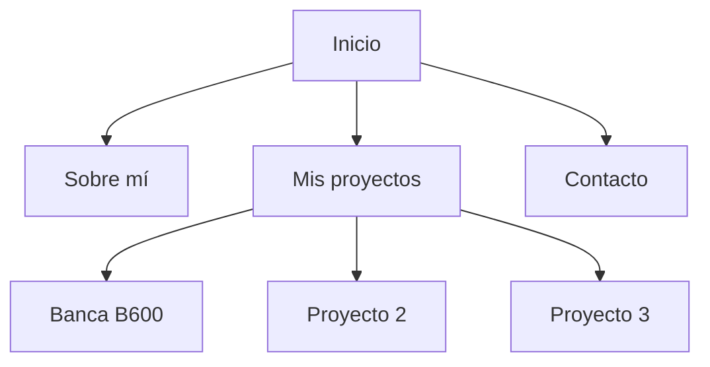

# Mi Portfolio - PEC 4

## Sobre el proyecto

Este es mi portfolio personal, realizado para la PEC 4 del Máster en UX/UI y Diseño Web de CEI.

He utilizado como referencia el diseño que preparé en Figma para la PEC 3. El objetivo ha sido trasladar ese diseño a HTML y Sass, manteniendo su estructura, colores y estilo visual.

## Herramientas utilizadas

- HTML
- CSS
- Sass
- Visual Studio Code
- Figma
- Live Server
- Live Sass Compiler

## Páginas

Mi portfolio contiene cinco archivos HTML:

- **Inicio (`index.html`):** presentación personal, proyectos y contacto.
- **Sobre mí (`sobre-mi.html`):** información sobre mi formación y conocimientos.
- **Banca B600 (`detalle-b600.html`):** presentación del proyecto de banca digital realizado en Figma.
- **Proyecto 2 (`detalle-proyecto2.html`):** página provisional para un futuro proyecto.
- **Proyecto 3 (`detalle-proyecto3.html`):** página provisional para un futuro proyecto.

Los proyectos 2 y 3 mantienen una estructura visual similar a B600, pero su contenido está pendiente de desarrollar.

## Organización de carpetas

- `assets/img`: imágenes utilizadas en el portfolio.
- `assets/icons`: iconos SVG de LinkedIn y GitHub utilizados en la sección contacto.
- `scss`: archivos Sass con las variables, componentes y estilos principales.
- `css`: estilos CSS generados a partir de Sass.

## Componentes reutilizables

He creado estilos que se reutilizan en diferentes partes de la web:

- **Botones:** para acceder a las secciones y páginas.
- **Tarjetas de proyectos:** para presentar B600 y los proyectos pendientes.
- **Contenedor principal:** para mantener márgenes y alineaciones consistentes.

También he utilizado Flexbox y Grid para distribuir los elementos.

## Navegación de la web

Este diagrama representa las páginas y secciones
principales de mi portfolio y como se conectan.

- A: Inicio
- B: Sobre mí
- C: Mis proyectos
- D: Contacto
- E: Banca B600
- F: Proyecto 2
- G: Proyecto 3

La navegación permite acceder a las distintas páginas y regresar a la sección de proyectos.

## Diseño

Se utilizó tipografía Inter y una paleta de negro, blanco y gris, siguiendo el diseño de mi PEC 3.

Para organizar los estilos he utilizado Sass, separando las variables y los componentes reutilizables de los estilos generales.

También añadí las reglas responsive para adaptar la distribución a escritorio, tablet y móvil.

## Cambios respecto al diseño de Figma

Durante la maquetación he realizado algunos ajustes:

- Adopté los espacios y tamaños para mejorar la visualización en diferentes pantallas.
- Incorporé capturas de mi diseño de B600 para presentar el resultado del proyecto.
- En la sección Contacto sustituí el enlace de correo electrónico por un enlace a LinkedIn para evitar publicar mi dirección personal.
- Mantuve los proyectos 2 y 3 como espacios provisionales, ya que todavía no están desarrollados.

Se intenta conservar el estilo minimalista y la estructura del diseño original.

## Pendiente para la PEC 5

En esta PEC he trabajado principalmente la estructura y la maquetación visual.

Las funcionalidades que requieran JavaScript, si se incorporan al proyecto, se desarrollarán en la PEC 5.

Los proyectos 2 y 3 continuarán como contenido provisional hasta que tenga nuevos trabajos para incluir.

